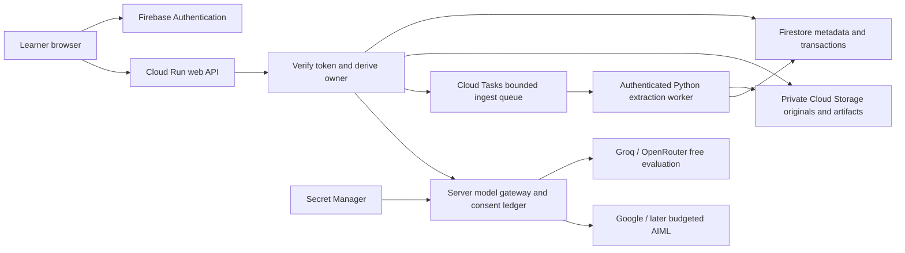

# Concrete cloud foundation and rollout

23 October 2026. Existing project: `kairo-access-20261021`. Fresh CLI audit confirms ACTIVE, billing enabled, required APIs enabled. Cloud Run inventory is empty **in africa-south1**; bucket and Firestore inventories are empty project-wide. These files record the actual responses. Promotional-credit balance was not checked or assumed.

## Authorized foundation

Prepare an empty Standard storage bucket `gs://kairo-access-20261021-materials` in Johannesburg (`africa-south1`) with uniform bucket-level access and enforced public-access prevention. Create dedicated `kairo-web-runtime@kairo-access-20261021.iam.gserviceaccount.com` with no downloaded keys and no project-wide permissions. Verify both after creation. No private material migrates, no public access is granted, no inference, database or compute instance starts. Empty storage and an unused identity are preparation, not a deployed application. Storage operations/data/egress incur normal charges when later used; this is not a lifetime-free service claim.

No Firestore database is created yet: its location/transaction model and ownership schema must be selected as part of the concrete migration. Do not mount SQLite on a Cloud Storage FUSE volume as a shortcut to durable transactional database semantics.

**Actual result:** bucket and identity created at approximately 23:06 SAST and re-described successfully. `public_access_prevention` is `enforced`, uniform bucket-level access is true, public IAM binding count is 0 and runtime user-managed key count is 0. No object was uploaded. The new bucket's default soft-delete policy is **7 days**; future object deletion must disclose this recovery/retention window and its storage-cost implications. It is not immediate permanent erasure. Retention/deletion UX must be settled before private learner material is admitted.

## Selected target topology

Use Cloud Run min-instances 0 and a small max-instances cap initially; separate heavier extraction/render jobs so page loads do not download models. These settings limit scale, not total monetary spend. Budgets are alerts; request reservations and app quotas enforce app limits. Verify current prices and a concrete spend ceiling before deploying cost-bearing compute. A missing provider/region must fail clearly rather than silently send private data elsewhere.

## Migration order and hard acceptance checks

1. **Identity**: explicit local/hosted mode, approved origin and verified Firebase ID token for every private operation. Server derives UID; never trust a client-supplied owner. Do not use a local gcloud user-token bridge in deployment. Anonymous guest identity may later be supported with separate short retention and visible limits; guest is not shared global storage.
2. **Owner-scoped storage**: `/users/{uid}/sources/{sourceId}` and immutable revisions, `/users/{uid}/lessons/{lessonId}`, drafts/version history, jobs and request quota records. Transactions preserve expected-revision/version semantics. Originals use owner-prefixed generated object IDs. Authorize before signed download issuance; short expiry is not a substitute for ownership checks. Firestore Admin SDK bypasses security rules, so server ownership checks remain mandatory.
3. **Durability**: canonical source/lesson metadata in Firestore, originals/artifacts in the private bucket; no original JSON, credentials, SQLite DB or private documents baked into an image. Cloud Run's writable filesystem is in memory and disappears when its instance stops. Existing local SQLite remains valid for local mode only.
4. **Jobs**: authenticated Cloud Tasks → worker, fixed command arguments, quarantine/signature/ZIP/pixel/time bounds, idempotency, job cancellation checked at commit, explicit partial-extraction coverage. Linux extraction cannot retain Windows-only venv paths. Task retry policy must not duplicate model charges or publish obsolete results.
5. **Secrets/IAM**: Secret Manager versions for Groq/OpenRouter/AIML added only from a secure local file or console. Grant access on named secrets and the exact private bucket, not Editor/Owner or all secrets. Attach the runtime service identity; do not create service-account key JSON. Keep keys outside frontend bundles and logs.
6. **Deployment gates**: synthetic account A uploads/reviews/edits/publishes/practises/resumes across service restart. Account B fails read/write/delete/export/retrieval even knowing A's object IDs. Unauthenticated private requests fail. Source/draft conflicts survive concurrency. Provider outage leaves source reading available. Only then invite a friend with private material or provide a judge URL/account.

## What is not complete

No hosted identity providers, tenant migration, database, worker, public web service or judge account exists from this foundation. Existing source routes deliberately remain loopback-only. The bucket is not wired to the app simply because it exists. The next root integration must own server/auth/repository/client-login interfaces explicitly; this task does not rewrite them while researching model capabilities.

Primary sources: [Cloud Run filesystem contract](https://docs.cloud.google.com/run/docs/container-contract#file_system), [Firebase ID token verification](https://firebase.google.com/docs/auth/admin/verify-id-tokens), [Secret Manager least privilege](https://docs.cloud.google.com/secret-manager/docs/best-practices), [Storage locations](https://docs.cloud.google.com/storage/docs/locations), [signed URL access](https://docs.cloud.google.com/storage/docs/access-control/signed-urls).
