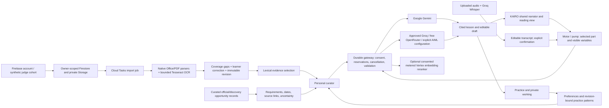

# Connected intelligence: 25 October 2026

## Learner path and decisions

Account → private material → bounded extraction and coverage review → corrected, hashed source revision → personal plan (goal, language, pace and practical role direction) → consented server gateway → source-linked lesson → KAIRO/reading → motor or pump exploration → practice → optional private pattern events → next lesson suggestion. Existing device notes, account progress and source revisions remain distinct.

The arrow from opportunities to personal goals represents learner choice; automatic requirement-to-evidence matching is not yet connected. Retrieval currently searches/reranks selected text from the current reviewed source, not every document or the public internet. Diagrams and image semantics are not inferred by OCR.

## Models, housing and orchestration

| Task | Current implementation | Boundary |
|---|---|---|
| Cited lesson and help | Server calls Google-managed `gemini-3.5-flash-lite`, or explicitly selected approved provider | Actual deployment config and live test evidence are recorded separately; citation validation is traceability, not factual certification |
| Free alternate text service | Groq `openai/gpt-oss-20b`; OpenRouter configured free slug or `openrouter/free` | Credentials stay server-side. Alternate requires separate consent, at most one retry on transient availability failure; no fallback for bad citations |
| AIML | Fixed-host adapter with explicitly configured model and positive cost reservation | Disabled until model and reservation are configured; historical $13 credit is not a current budget |
| Retrieval embeddings | Optional Google-managed `gemini-embedding-001`, 256 dimensions, at most eight candidates plus query | Separate metered request and explicit Google consent; flag off by default. No persistent global vector index |
| Listening | Groq-hosted pretrained `whisper-large-v3-turbo`; uploaded audio ≤8 MiB | No automatic microphone opening. User edits and confirms the transcript before making a question. Language accuracy unvalidated |
| Personal curator | Transparent revision-bound pattern rules plus language/pace/goal instructions to the lesson model | Repeated unsupported answers suggest an example; unknown assistance never becomes independent skill/mastery |
| Learner prediction | Versioned event package and reproducible synthetic CPU logistic baseline | Offline synthetic evaluation only; no learner prediction model trained on real users or promoted into production |
| SASL | Existing landmark/capture work remains separate | No claim of translation, recognition or signer-validated output. Requires signer-reviewed data and evaluation |
| Future specialist pretrained models | Prior research includes BGE-M3 and speech/vision candidates | No unmeasured GPU service or downloaded model is silently deployed |

Cloud Run hosts the authenticated application; Firestore and Storage preserve owners; Cloud Tasks handles durable imports. The gateway orchestrates typed model requests. Kubernetes is not required for this managed-inference pilot. The read-only Terraform root in `infra/ai-wave-20261025` discovers the existing service without attempting to take ownership from the release process. Terraform 1.17.0 is installed locally with the official checksum verified; provider initialization and configuration validation passed. No cluster or Terraform apply is claimed.

## Cost and privacy controls

- Owner/day durable reservations and request-ID deduplication survive restarts. Reservations are conservative controls, **not reconciled provider bills or guaranteed monetary limits**. Global existing generation/voice quotas remain in place; no paid provider is enabled merely by naming it.
- AI records can retain selected passages, outputs and transcripts privately. Raw listening audio is not written by the transcription route. Provider-side retention and data processing policies remain separate and require product policy review before a real learner pilot.
- Optional semantic processing sends selected text to its configured Vertex region (default us-central1), distinct from Johannesburg record storage. It remains off until the region, budget and acceptance are approved and measured.
- The new opportunity page does not scrape authenticated social accounts, submit applications, contact employers or guarantee current eligibility. A seven-day stale check changes status to unknown.
- Account sharing, IAM-private website access, Firebase sessions, source-revision checks, draft CAS, one narrator, stop/reading controls and denied browser-observation boundary remain.

## Evidence and remaining product work

Automated evidence: ai-final.txt, affected-regression.txt, extraction/listening/opportunity worker handoffs, build-release.txt, staging manifest and live-ai-check.json when produced. Final serial regression: 741/741 pass. The earlier run found two repaired regressions; a parallel SSR startup stall was isolated and the account panel also passed 7/7 separately. Human/browser/device acceptance remains open.

Still open: owner-filtered retrieval across multiple approved sources, curriculum and role records; an indexed semantic corpus; scheduled permitted source refresh; CV/evidence-to-role gap matching; employer opt-in sharing and rewards; microphone UX with device tests; terminology/voice review across languages; SASL dataset/signers/evaluation; real consented learner data, baseline comparisons and fairness evaluation; full retention/deletion/recovery drills; affordable-device usability and externally verified judge access. These remain visible priorities, not omitted capabilities or implemented claims.

## Research references

- [Google Gemini 3.5 Flash-Lite](https://ai.google.dev/gemini-api/docs/models/gemini-3.5-flash-lite)
- [Vertex embedding requests and task types](https://docs.cloud.google.com/vertex-ai/generative-ai/docs/embeddings/get-text-embeddings)
- [Groq speech-to-text](https://console.groq.com/docs/speech-to-text)
- [OpenRouter free router](https://github.com/OpenRouterTeam/docs/blob/main/guides/routing/routers/free-router.mdx)
- [Terraform Cloud Run resource/import](https://registry.terraform.io/providers/hashicorp/google/latest/docs/resources/cloud_run_v2_service)
- [GKE ML workloads](https://docs.cloud.google.com/kubernetes-engine/docs/concepts/machine-learning)

Prior supplied research remains in docs/agentic-cloud-20261023, docs/language-ml-research-wave2 and docs/provider-hosting-review-20261024. This wave implements a bounded subset without asserting that all research recommendations are production-ready.
