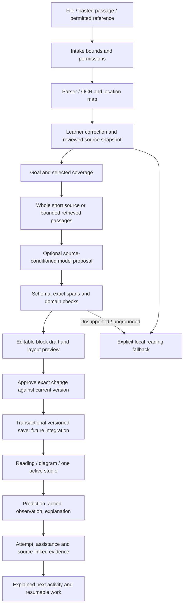

# Source to editable learning: reviewed architecture

23 October 2026. Root decision synthesis, not a production deployment. The attached Google AI response is a research lead. Its instructions, code, citations and blanket library claims are not accepted automatically. Worker alternatives are proposals; the bounded kit contract is the only executable schema delivered by this task, and remains isolated from the app.

## Product mechanism

The learner owns a source and a goal. KAIRO proposes a small lesson whose parts can be edited and rearranged. The learner sees the supporting source, changes the explanation or layout, approves a proposed revision, tries a supported activity and keeps the reasoning. Layout adapts to the task and explicit preferences; it must not diagnose a fixed learning style.

Keep three independent things: **source truth as recorded**, **teaching content and review status**, and **presentation/activity configuration**. Correctly quoting a wrong source does not make its claims true. Beautiful presentation does not validate a question key or learning outcome.

## Every step: tools, intelligence, output and recovery

| Step | Input and work | Tool/method decision | Intelligence boundary | Output and failure recovery |
|---|---|---|---|---|
| 1. Admit | File or reference plus owner, intended use and limits | Existing upload route allowlist; add magic/container/pixel and expansion bounds before broader release | No LLM needed; references do not grant scraping rights | Intake manifest; reject unsupported/encrypted/oversized content without losing previous work |
| 2. Extract | Immutable original bytes | Current local parsers/OCR first. Corpus-test alternatives rather than replace all parsers | OCR is uncertain recognition, not subject understanding | Located pages/sections plus method/warnings; preserve original, ask for clearer image or paste |
| 3. Normalize | Characters, tables, formulas, page positions | Versioned normalization with original-offset mapping; retain formulas and table structure separately | A VLM may propose interpretation only if needed, consented and marked for review | Exact original text + corrected derivative; no silent formula repair or invented table cell |
| 4. Review | Original and extraction comparison | Original-page viewer and controlled text editor; learner acknowledgement and immutable source revision | Human review records what was checked, not an official answer memo | Saved reviewed snapshot; corrections create a new revision and stale-dependency warning |
| 5. Resolve intent | Goal, selected sections, depth, read/worked/practice, explicit access preferences | Controlled form, bounds, inspectable choices; one clarification if required | Model may suggest, never infer disability/intelligence/learning style | Brief revision; changing it invalidates pending generation, not saved source |
| 6. Select evidence | Reviewed snapshot + brief | Small source: include bounded selected material. Longer: section/lexical ranking first; embeddings only after evaluated recall failures | Selection scores are ranking signals, not factual confidence | Passage IDs, exact offsets, coverage and omitted sections; show insufficient support explicitly |
| 7. Plan | Brief + passages + capability registry | Simple source: one draft call. Complex request: optional outline then one draft, maximum two calls by default | LLM proposes sequence, prerequisites-as-questions and activity candidates | Draft outline; no invented missing prerequisites, unsupported studio or automatic model-agent loop |
| 8. Draft | Approved brief/outline and exact evidence | Existing Google structured output adapter first, extended under separate ownership; no automatic AIML fallback | Language generation where flexibility helps; calculator outputs remain code | Bounded blocks, references, provenance and issue list; timeout/refusal preserves local reading |
| 9. Check | Candidate data | Strict schema + exact revision/quote/locator checks + reviewed domain functions | Semantic entailment and answer correctness still need review; second LLM is an optional critic, not an oracle | Accepted structure + unresolved issues. Invalid output is not executed, silently repaired or claimed reviewed |
| 10. Edit | Draft blocks + learner changes | KAIRO-native fields, add/remove/reorder with buttons; optional Puck layout spike later | Manual edits do not need LLM. “Make this shorter” produces a targeted proposal | New draft; preserve source references, distinguish excerpt from edited explanation, undo supported |
| 11. Compare/approve | Base snapshot, proposed result, source/brief revisions | Human-readable diff + exact base/result digests; server authenticates approver | Model cannot mark its own output approved | Approval bound to current bytes; any later edit needs fresh approval |
| 12. Commit | Approved proposal | Future expected-revision/If-Match + transactional store; immutable snapshots | No model | One new version. Concurrent save gets conflict, preserves both drafts, no last-write-wins |
| 13. Render | Valid saved lesson + template | Allowlisted React renderers; separate content from reading/split/practice layout | Task-driven rule chooses a suggested template; learner can change it | Reading always available. No arbitrary generated HTML/CSS/JS; unsupported block becomes an explicit issue |
| 14. Explore | Reviewed activity and learner action | Motor calculator or pump domain adapter with typed inputs, units and bounds | LLM may suggest an allowed action; code and current session authorize it | Calculated/simulated observations labelled correctly, one heavy scene, no claim to actuate real equipment |
| 15. Practise | Prediction, answer, explanation, hint exposure | Reviewed key for closed tasks; ungraded reflection/educator review for open ambiguity | Model feedback is advisory. No mastery/reward/employment claim from a correct answer | Attempt tied to item/rubric/source version with assistance unknown where unrecorded |
| 16. Continue/export | Accepted attempts and saved work | Transparent recommendation rules first; JSON bundle and escaped reading projection | Later ML requires consented labelled data, held-out evaluation and baseline comparison | Resume same version, or explicit migration; failed save preserves draft and offers export |

## Library decisions and rejected shortcuts

1. **Canonical data first.** Keep KAIRO source/revision IDs (24-hex for records), stable block IDs, content provenance and layout separate from editor internals. Do not adopt the pasted UUID/content-string/z.any/free-width/action-string schema. It lacks critical bounds and domain identity.
2. **Immediate editing:** native controlled blocks with keyboard move-up/down, content edit and undo. The existing panel handles only the brief; it is not a block editor. This task supplies an isolated contract spike, not the live editing UI.
3. **Layout candidate:** Puck core is the strongest scoped composition candidate after schema approval. Test fixed lesson components and two named layouts in isolation before any main manifest change. Use static placeholders in the editor for 3D; avoid two WebGL/teacher instances. Puck editor data is an adapter format, not the authoritative learning record. [Official data model](https://puckeditor.com/docs/api-reference/data-model/data).
4. **Prose editor later:** choose either BlockNote core for ready-made blocks or Tiptap/Lexical for precise custom inline controls. Do not install a composer plus two rich-text frameworks. Package/licence distinctions and lossy export are in the editor memo.
5. **Validation:** propose JSON Schema as the interchange specification and one production validator after a dependency decision. Zod is a viable TS-first alternative with JSON Schema conversion; some Zod types cannot be represented. Neither replaces quote verification, authorization, diff, undo or persistence. The isolated kit uses built-in checks and publishes a schema without installing a validator. [Zod conversion limitations](https://zod.dev/json-schema).
6. **No automatic H5P/Adapt rejection:** they are potential mature course/interchange tools, with licence, runtime and data-boundary costs. An iframe or older implementation is not proof of React incompatibility. Use only when an actual educator/course packaging need outweighs integration costs.
7. **No arbitrary artifact execution:** bounded JSON and fixed renderers now. A future code/HTML artifact worker needs separate origin, sandbox/CSP, no private credentials and tightly typed messages. A preview iframe is not automatically that sandbox. [OWASP source-injection controls](https://cheatsheetseries.owasp.org/cheatsheets/LLM_Prompt_Injection_Prevention_Cheat_Sheet.html).

## Models and exchanges

Current source code default in google.mjs is gemini-3.5-flash-lite, overridable by environment. This code default is not proof of current account entitlement, serving model, region, quota or prices. Existing Google route sends reviewed excerpts with responseMimeType/responseSchema; API support is model/endpoint-specific. AIML prototype sends JSON-object mode, not this complete task schema. Do not copy a Gemini API schema blindly into Vertex or every AIML model. [Google response schema example](https://docs.cloud.google.com/vertex-ai/generative-ai/docs/samples/generativeaionvertexai-gemini-controlled-generation-response-schema-2), [actual AIML provider documentation](https://docs.aimlapi.com/).

Provider selection is server-owned: fixed task -> verified model capability -> current price quote -> explicit provider consent -> reserve bounded cost -> dispatch with source/brief/request versions -> validate -> propose. No fallback after cancellation, stale source, invalid citations or permission failure. A second provider is allowed only if independently consented/configured/priced; otherwise use explicit local reading. No automatic spend across the user's historical $13 credit claim.

Small input should not pay for five sequential AI agents. Proposed cap: one draft call for a simple source, two calls for an approved complex outline/draft flow. Zero repair calls by default. Each call gets a bounded source/token/output size and shared wall-clock deadline. Human approval waiting is not a model job. Long extraction is a separate cancellable job. The kit does not invoke either provider.

Cloud migration remains a separately reviewed stage: authenticated API on Cloud Run, originals/immutable exports in private object storage, durable owner-scoped lesson/source versions with transactional expected-version writes, bounded extraction/render jobs, server-only provider credentials, budget ledger and deletion dependencies. Cloud Storage/Firestore/Cloud Tasks are candidates; no product/region/billing capability is assumed available until checked against the selected project. Do not move mutable local JSON files to an ephemeral Cloud Run filesystem and call it durable storage. Decide residency and provider retention before private material use.

## Intelligence you can inspect

The useful intelligence is an explicit decision with a reason: “This source defines a formula; use a worked calculation, then a changed-input question.” It chooses from registered capabilities, checks missing inputs and separates source values from authored examples. It should show the selected passages and why a shorter explanation or practice task was proposed.

No trained learner prediction is claimed. Evaluate retrieval, explanation support, numeric/unit correctness, question ambiguity, request adherence, time/cost and revision safety separately. Future knowledge tracing/ranking must beat a transparent rule baseline on held-out learners and reviewed items; source/learner leakage, unreliable labels and feedback bias require controls. See the intelligence research memo for primary learning evidence and its limits.

## Concrete engineering lesson

Title: **Predict the rotating field speed, then explain what the number means.** Source: DOE motor sourcebook, printed p6; exact formula supports synchronous field speed, not loaded shaft speed. Use 50 Hz/four poles as explicitly authored practice inputs: 120 × 50 ÷ 4 = 1,500 rpm. DOE's adjacent worked examples in this edition use 60 Hz; do not attribute our 50 Hz example verbatim to DOE. [Official sourcebook](https://www1.eere.energy.gov/manufacturing/tech_assistance/pdfs/motor.pdf).

Card order: source rule -> learner prediction -> authored calculation -> change frequency holding poles fixed -> explain field-versus-shaft limit -> changed-input check -> keep working with assistance record. Current EngineeringStudio has no external setters/callbacks except onExit. Its frequency/pole calculator does not rebuild the visual winding. The kit only admits activity data and generates a reading report; live dispatch requires the separate adapter in the studio memo.

Pump is a second authored activity: predict delivery, change bounded speed/valve, inspect simulated readings, explain evidence, diagnose/repair/confirm. The 12 L/s target and model limits are authored case values, not universal pump ratings. Pump interface/evidence/resume remains unmounted and unagreed. Do not pretend either activity is an equipment digital twin or safe live electrical guidance.

## Save, undo and portability

Prefer dirty-state tracking, short debounced saves, explicit save/exit flush and visible commit acknowledgement. A blind 30-second save loop can lose recent work and cause stale overwrite. Preserve current draft on quota/error; export is a recovery path, not a claim of cloud sync.

Use strong expected-version commits to prevent lost updates. An approved edit is bound to exact base+result; undo restores prior content as a new version, never rewinds the audit trail. The kit demonstrates in-memory checks; database transactions/history/authentication are still absent. [If-Match semantics](https://developer.mozilla.org/en-US/docs/Web/HTTP/Reference/Headers/If-Match).

Keep source revision hash (native current reviewedPages byte serialization), lesson content digest and original-file digest as separate fields. The kit's key-sorted JSON digest is local, not a signature or an implementation claim of [RFC 8785 JCS](https://www.rfc-editor.org/rfc/rfc8785). Version canonicalization explicitly before cross-language deployment. JSON Patch is an optional later transport, with path/operation allowlists and full result validation, not an executable authority. [RFC 6902](https://www.rfc-editor.org/rfc/rfc6902).

## Exact current request budgets and a UI mismatch to fix

Current upload permits 8 MB, first four pages/slides/sheets, at most16,000 displayed characters per section; reviewed save permits48,000 total and at least one80-character section. Four full16,000-character extracts can therefore exceed the save budget. The review UI must explain the total and chosen coverage rather than surprise the learner on save. Existing generated evidence includes first12,000 reviewed characters; learner goal is at most300. Google generation caps4,500 output tokens and60-second request timeout; upload subprocess has120-second timeout. These are observed code limits, not target quality/performance claims. Expand selection/page controls with budget-aware coverage, not silent truncation.
