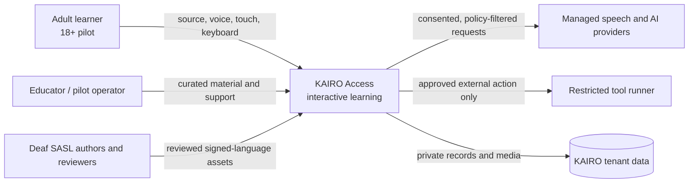
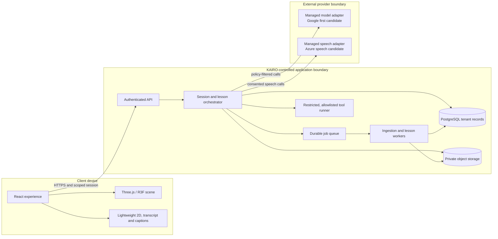
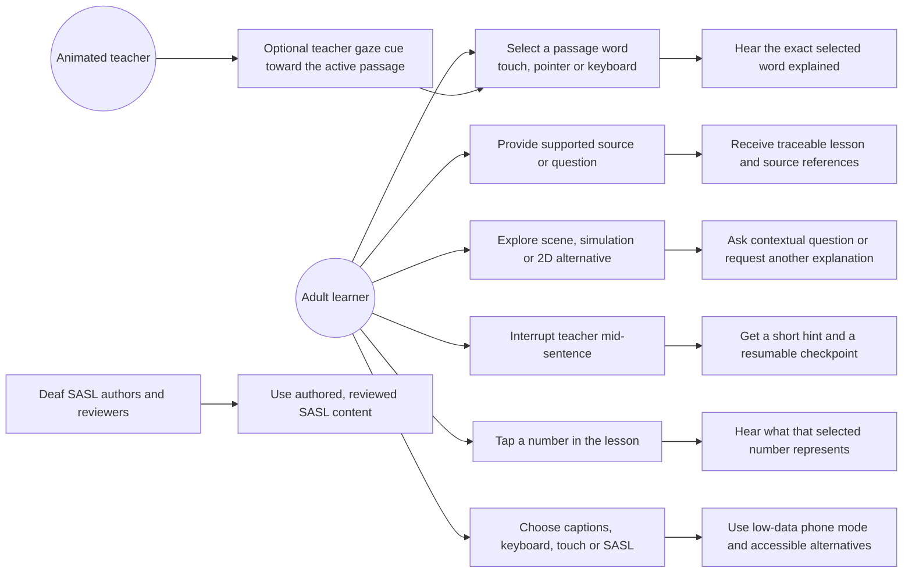
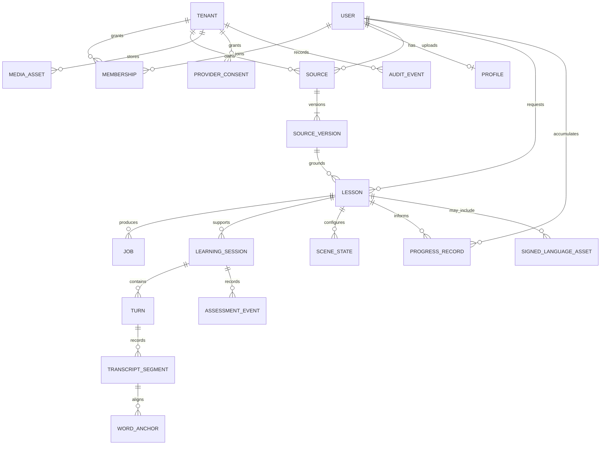

# KAIRO blueprint and identity

**Status: proposed future design.** These diagrams describe a target architecture and experience for KAIRO Access. They do not claim the current local prototype already implements this architecture, accessibility behavior, speech alignment, cloud service or security posture. The confirmed pilot audience is adults aged 18 and over.

Start with the [target architecture visual](kairo-target-architecture.html), then use the editable diagrams below to inspect the wider platform, data, and interruption behavior. Source files are Mermaid and JSON. Treat the [logo kit](logo/README.md) as provisional pending user selection and trademark review.

## C4-style context



## C4-style container view



**Platform choices are candidates.** The target keeps 3D rendering on the client; it does not assume cloud GPU video. Ingestion, OCR, lesson packaging and other long-running tasks run asynchronously. Managed services sit behind adapters so provider choice, consent, cost and fallback can be reviewed independently. Tenant isolation, retention, encryption, deletion, monitoring and provider terms need implementation decisions and validation before deployment.

## Learner use cases



### Interaction rules

- A word anchor identifies a transcript word and its source span. Learners select a passage word with touch, pointer or keyboard. Teacher gaze toward the active passage is a separate optional presentation cue; learner gaze input is not required by this design. Word anchors are separate from viseme or mouth-shape animation data. Word-to-audio alignment must be measured on actual voices and languages; no precise timing is promised before that evidence exists.
- A mid-sentence interruption is one atomic turn change: cancel the current generation and playback, checkpoint the learner's place, and only then present a short hint. Stale work must not append after the new turn.
- The teacher can show small listening nods while the learner types or speaks. Keep these subtle, interruptible and disabled or reduced with motion preferences.
- The phone route should minimize transfer and avoid requiring 3D assets. Offer text, captions, compressed audio where available, and resumable downloads. Measure actual data use before stating a target.
- SASL material is authored with Deaf contributors and reviewed by Deaf reviewers. Generated or unreviewed signing is not represented as validated SASL.

## Proposed data model (ERD)



Identity follows the proposed core data model: one `USER` may have memberships in multiple `TENANT`s; `MEMBERSHIP` carries tenant-specific role and status; and `PROFILE` is attached to the user, not copied once per membership. Tenant-owned records retain `tenant_id` and server-side authorization. A membership joins a person to an organization; it does not create another person identity.

Every tenant-owned row carries a tenant key and is accessed through a server-checked tenant scope. Object references are private identifiers, not public URLs. `WORD_ANCHOR` stores text identity and optional measured audio offsets; viseme timing belongs to a separate animation track. A SASL asset records authorship and Deaf-review provenance. This is a proposed conceptual model, not a migration-ready schema.

## Interruption sequence

```mermaid
sequenceDiagram
  actor Learner
  participant UI as KAIRO client
  participant API as Session orchestrator
  participant Gen as Lesson / speech generation
  participant Store as Session store
  Learner->>UI: Interrupt with "I'm stuck" (voice, text or tap)
  UI->>UI: Atomically advance turn epoch; stop local playback
  UI->>API: Interrupt(turn_id, new_epoch, checkpoint)
  API->>Store: Save checkpoint; mark prior turn cancelled
  API->>Gen: Cancel prior generation and speech work
  Gen-->>API: Cancellation acknowledged or stale result
  API->>API: Reject output from prior epoch
  API->>Store: Append short hint to the new turn
  API-->>UI: Hint + resumable position
  UI-->>Learner: Show and speak hint; keep captions available
```

Cancellation across a network is best-effort, so the server also checks the epoch before persisting or returning generated output. If cancellation acknowledgment is late, stale output is discarded. The client keeps the checkpoint usable if speech or network calls fail.

## Interruption lifecycle

```mermaid
stateDiagram-v2
  [*] --> Teaching
  Teaching --> InterruptRequested : learner says / taps "I'm stuck"
  InterruptRequested --> PlaybackStopped : stop local audio and advance epoch
  PlaybackStopped --> CheckpointSaved : save current place
  CheckpointSaved --> CancellingPriorTurn : cancel generation and speech
  CancellingPriorTurn --> HintReady : cancellation confirmed
  CancellingPriorTurn --> HintReady : timeout; prior epoch fenced
  HintReady --> Teaching : deliver concise hint; resume on learner choice
  Teaching --> Paused : learner pauses or leaves
  Paused --> Teaching : resume from saved checkpoint
  InterruptRequested --> RecoverableError : checkpoint cannot be saved
  RecoverableError --> Paused : retain local recovery point
```



## Local prototype boundary

The repository currently has a local development application with a computer-science request trace, Lecture Theatre, Engineering Studio, source extraction and cited lessons, browser-local progress, a workplace case, pathway preparation, and a teacher rig/voice rehearsal. Optional Google services require explicit consent. Those facts describe the current local prototype; they do not demonstrate this target's tenant architecture, production security, exact word timing, SASL quality, phone data budget, or measured educational benefit.

## Validation status

The standalone architecture specification is checked by the Archify renderer in showcase mode and delivered as a frozen HTML artifact. That validates diagram structure and composition only. No browser-size, device, accessibility, provider, security, timing or perceptual review is claimed. Those remain acceptance work.
