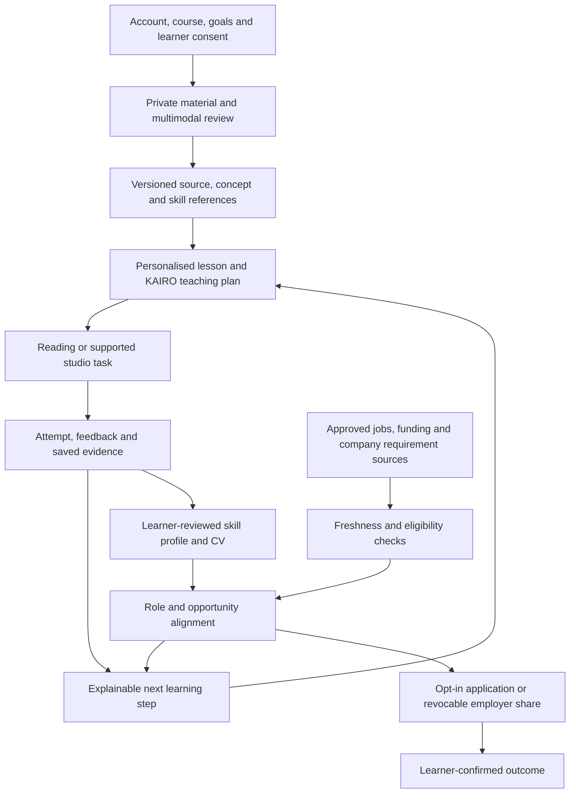

# KAIRO: the full learner-to-opportunity product

24 October 2026. This corrects the earlier canvas's overly narrow presentation. The full agreed product belongs in the proposition. Delivery labels identify gaps; they must not erase the vision.

## The promise

**KAIRO connects who you are and what you study to how you learn, what you can demonstrate, and the opportunities you can prepare for.** It brings personalised, multimodal learning and practical environments together with role-aligned skill development, learner-controlled evidence/CV building, relevant jobs/training/funding updates, and accessible ways to participate. Reducing barriers between education and employment is the intended impact. Actual employment effects require evidence; a match or practice level is not a job guarantee.

The journey is **profile/course/year/goals → reviewed multimodal material → personally curated lesson → KAIRO in a relevant studio or reading → practice and adaptation → evidence/skill profile → sourced role requirements and gap plan → further learning/projects/certificates → current jobs/bursaries/NSFAS/hackathons → learner-confirmed applications/share → outcomes and next steps**. Spoken languages and SASL access run across this journey, not as an unrelated decorative page. A private individual can start with a goal/material and optional CV; institutional/workforce learners enter a scoped course/company environment. CV upload must not be mandatory to study.

## Full capability, actual position and required bridge

| Capability | Evidence now, from source and dated handoffs | What completes the intended experience |
|---|---|---|
| Personal account, course, year and module context | Private accounts and two fictional curriculum-scoped engineering/informatics judge profiles; module/studio links. | Self-serve profile/goal and optional CV confirmation, real authorised institution rosters, permissions and programme taxonomy. The fictional accounts are not university integrations. |
| Personalised lesson curation | Goal-based source selection, cited editable lesson, basic progress-based next actions. | Feed learner-confirmed goals, prerequisites, language/access preferences and revision-bound attempts into lesson planning; explain why the next step was chosen; let learners override it. No fixed “learning-style” diagnosis. |
| Multimodal understanding | PDF/DOCX/PPTX/XLSX/text plus bounded OCR; originals/review and source citations. | Page/slide/cell/timestamp-aware representation, coverage report, diagram/table/formula interpretation, audio/video transcription, reviewed cross-modal retrieval. Avoid silent truncation and invented image interpretation. |
| KAIRO teaches in studios | Prepared motor/pump/API activities, contextual text/narration, learner control and saved working. | Align each lesson objective with one supported observation/action, prediction, explanation and rubric; carry context between classroom and studio. Generated interactive HTML needs a validated declarative contract or separate sandbox, not arbitrary script execution. |
| Adaptation and skills | Local progress; isolated adaptive policy/adapter; manual role evidence rubrics. | Versioned concept/skill IDs, independent vs assisted attempt events, reviewed task descriptors, learner-visible next-step policy and learning replan. Distinguish self-report, attempted work, assessed work and externally verified credentials. |
| Role alignment, CV and employability | `/direction`, `/pathways` and a separate applicant-confirmed CV draft. Examples include closed/historical vacancies. | Current sourced role requirements → explainable skill/evidence comparison → gap-specific lesson/project → updated evidence/CV. Missing evidence means unknown, not inability. No invented hiring probability. |
| Opportunities, NSFAS/bursaries and updates | Dated research/validator foundations; no live feed/updater. | Approved source connectors, freshness/expiry/withdrawal, eligibility facts with unknowns, saved interests, learner-controlled alerts and official application links. Basic public funding guidance should remain accessible; KAIRO does not charge to submit NSFAS applications or determine funding. |
| Employer matching and company training | No employer portal, verified matching, institutional tenancy or company training contract. | Employer-owned competency/task requirements, rights-cleared training material, rubric-approved scenarios; employee/learner consent; company-scoped reports; opt-in revocable evidence sharing. Company use must not secretly become hiring/surveillance scoring. |
| Multilingual text, listening and speech | Draft cited-span translation in six named language options; device voice choices; hosted English voices. | Qualified speaker evaluation, full task/lesson language state, terminology glossary, voice/STT language coverage, transcript/correction/cancel flow. Text translation, STT and TTS are three separate services. |
| SASL | Explicit local camera consent and MediaPipe hand landmarks only. | Co-design with Deaf SASL educators; rights-cleared, reviewed signed content first; separately evaluate recognition and expressive signing using face/body/nonmanual grammar. Continuous bidirectional SASL translation is specialist R&D, not supplied by an English LLM or hand tracker. |
| Full deployment and reliable access | Latest recorded private Cloud Run revision `kairo-app-00006-885`; 692 tests and 18 synthetic API checks in that release evidence. | Judge-appropriate authorised access, real-device acceptance, retention/deletion/support operations, abuse/cost controls, language/source quality, and scaled tenant/billing tests. Public reachability has not been established. |

Evidence: [wider pathway audit](../full-journey-market-audit-20261024/KAIRO-WIDER-PATHWAY-AUDIT.md), [model/access audit](../full-journey-access-audit-20261024/README.md), `studio/src/adaptive/`, `studio/src/adaptive-bridge/`, `studio/src/pathways/`, `studio/src/cv-workspace/`, `studio/src/learning-flow/`, `studio/server/learner-workspace/`, `studio/server/google.mjs`, `studio/src/signing/` and the security release handoff. These are code/recorded API evidence, not new live cloud or browser checks in this task.

## The services communicate through one owned learner record

**Architecture plan, not all implemented:** Firebase authenticates; owner/tenant-controlled Firestore stores source/lesson/evidence/profile references; private Cloud Storage holds originals/audio only for agreed retention; Cloud Tasks runs bounded jobs; an application tool broker validates model tool arguments and enforces account, consent, timeout, cost and output schema. Grounded generation selects evidence and calls a suitable model through server credentials. No model gets unrestricted cloud administration, arbitrary web URLs, private cross-owner retrieval or autonomous application/payment powers.

Approved retrieval returns typed records, not just a fluent answer: `sourceURL`, source authority/licence, publication/retrieval/last-check times, content hash, closing time and timezone, eligibility facts with supporting excerpts, withdrawn/expired status, and confidence/unknown fields. Separate a role family from a current vacancy. A stale or closed record cannot be promoted to “open” because a model remembers it. Refresh cadence must match the source and budget; “real time” requires measured source/update latency. No background schedule was enabled here, and the deleted schedule remains off.

Job/funding connectors should begin with official employers, university financial-aid offices and NSFAS, plus authorised feeds. LinkedIn explicitly restricts unauthorised scraping/automation in its [User Agreement](https://www.linkedin.com/legal/user-agreement) and [help guidance](https://www.linkedin.com/help/linkedin/answer/a1341387). Use permitted APIs/partnerships/user-provided links, not a blanket scrape-everything promise. [NSFAS official guidance](https://www.nsfas.org.za/content/how-to-apply.html) is the authority for its application channel; eligibility/deadlines must be rechecked against current policy. No KAIRO model can approve a bursary.

## Models: use, host, improve

- **Grounded planning/lesson/help:** current Google Vertex route; next add a tested server adapter/fallback contract for Groq/OpenRouter/AIML. Existing provider experiments are not production failover. Keys stay server-side; only approved context goes to an explicitly consented provider. A free model's rate limit, routing/data terms and availability need a fresh check before use.
- **Extraction/vision:** native parsing first, then selectively priced OCR/layout and vision for pages that need it; reviewed source anchors survive every transform. Document AI is a candidate, not currently mounted. The model must report unreadable/omitted material rather than claim full understanding.
- **Listening:** add a speech-to-text path, correcting transcripts before storing/using them. Speech recognition is not translation. Use a supported managed route initially; evaluate self-hosted Whisper-family alternatives against local languages, latency, device/GPU cost and licences before deployment.
- **Language/voice:** translate selected supported text with a glossary and source comparison; route to a validated matching voice if available; maintain one KAIRO identity. Do not equate a UI locale with a tested South African-language voice.
- **Adaptation and role ranking:** connect the existing transparent policy and sourced requirement/skill graph before training a predictor. Later ML needs consented attempts, task/learner-disjoint evaluation, calibration, bias/error analysis and a baseline. A new source or job listing is normally a retrieval update, not a fine-tuning job.
- **SASL:** reviewed signed-learning content can be a bounded deliverable; continuous recognition/translation/generation needs a separate programme and signer/community validation. Kaggle GPU availability may support offline experiments, but free compute does not supply data rights, annotations, a deployment SLA or a valid translation model. No private learner video upload or training is authorised by this plan.

## Payment and company workflows

Individual: visible plan/allowance and cancellation terms → hosted checkout → verified server notification → idempotent payment ledger → account entitlement → receipts/refund flow. A browser success redirect cannot grant access. Institutions: signed scope/PO → invoice → authorised roster/seat allocation → reconciled payment and contracted access start → term/usage/support tracking → renewal. No double billing a sponsored learner for the same entitlement.

Company training: private company materials and role/competency matrix → agreed learning objectives and safety/assessment limits → quoted module authoring/review → customer acceptance → employee seats and role-specific practice → restricted reporting and revision management. A company's existing staff are distinct from external talent matching. An employer's sponsored student challenge is another explicit agreement, not automatic access to student profiles. All planned employer views require learner consent, purpose limits and revocation.

Pricing/COGS/development detail, payment amounts and recurring-versus-project revenue are in [FULL-PLATFORM-COSTS.md](FULL-PLATFORM-COSTS.md). No payment integration or charge was deployed by this documentation task.

## What happens next, in order

1. **Connect the existing pieces:** learner-confirmed course/goal/role → current source-bound task → saved evidence → visible requirement gap → next lesson. Use one engineering role and one reviewed requirement set; no need to create six more studios first. Acceptance: an evidence update changes a traceable gap/next task without promoting self-report to a credential.
2. **One reliable opportunity source:** approved official connector with provenance/expiry and manual refresh first. Acceptance: a changed closing date/withdrawal updates the UI; stale/unknown stays labelled; eligibility missing data stays unknown. Add funding source in the same contract. Automated refresh is a separate explicit task; no reinstated old schedule.
3. **Coverage-correct multimodal intake:** measure which pages/figures were processed, retain anchors, selectively call layout/vision, add one audio transcript type. Acceptance: mixed source errors are visible and correctable, unsupported types have a truthful path, and spending is capped.
4. **Language/access vertical slice:** one chosen language pair reviewed by a fluent speaker, text+listening+speech with cancellation and source fallback; one scoped, signer-reviewed SASL learning resource. Acceptance is by actual users/reviewers, not “model said it translated.”
5. **Tenant and payment service:** scope/billing ledger, source confidentiality, seat sharing prevention, collection/retry/refund/expiry tests, then actual institution/company onboarding. Charge only for a delivered contracted package.
6. **External acceptance and release:** resolve authorised judge access, recover failures, verify user journeys on devices, then a staged rollout. Repo tests are not user acceptance.

These are implementation packages, not completed deployments. The earlier discussion spans 21–24 October, but recorded time does not prove all requested features were implemented. Existing foundations reduce integration work; language/community review, authorised data access and purchasing remain external dependencies. A reproducible planning estimate in the full-cost document is **840 engineering/review person-hours** for a bounded version of the remaining packages, not continuous SASL and not an elapsed-date promise. Do not divide those hours by all chats as if every task can run concurrently. The honest next progress report should name each delivered bridge, remaining dependency and acceptance result instead of repeating research recommendations.

## Judging and learning-to-employment impact

The full proposition belongs in all seven criteria: Product connects the journey; Creativity links personal material to practical evidence and real requirements; Usability offers one next action and access choices; Sustainability separates institution/workforce subscriptions from custom work; Impact tests learning, opportunity access and later employment separately; Presentation shows the whole story with implemented/planned labels; Intelligence explains adaptation, source freshness and role gaps. Measure task completion, independent transfer and corrected errors; then opportunity freshness, appropriately explained matches, applications/interviews and learner-confirmed employment where consented. Do not infer unemployment reduction from visits, a skill badge or a model's match percentage.
