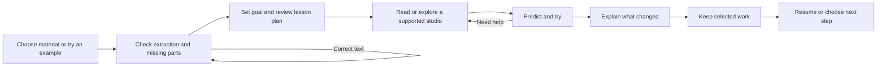

# A coherent KAIRO learning workspace

Design proposal, 24 October 2026. User problems/feelings below are hypotheses to test, not interview results. This is a source-informed specification, not a rendered UI audit, visual acceptance or runtime delivery. Preserve KAIRO's current identity and simple learner words.

## What governs the current surface

studio/src/kairo/AppShell.tsx imports navigation.ts and kairo.css. The navigation exposes Home, My material, Studios, My work and My direction. The shell states local development storage scope. kairo.css provides the local Manrope variable font and C palette: Chalk #f5f0e6, Moss #3e5144, Sage #a7af91, Ink #252b28. SourceWorkspace.tsx handles choose/review/plan and explicit local/cloud generation. lesson-draft-core/model.ts already validates reading/split/practice layouts and explanation/worked-example/question/reflection blocks. Do not introduce an unrelated design system alongside these.

Current evidence reviewed: docs/account-wave-20261024/, docs/first-use-audit-20261024/, source navigation/shell/styles/draft model. AccountPanel is unmounted; account-backed source/lesson history, source-to-pump bridge and shareable employer profiles are not delivered by this research.

## Keep the learner's place

Global navigation should remain stable. Within a lesson, show Learn / Practise / Keep my work plus a clear current source and return point. Course/module filtering changes relevant content, not the entire navigation on every model response. New guests can start without a CV or university account. Ask course/year only when it improves a real task; 'I'm learning on my own' is a valid path. Institution enrolment must come from trusted provisioning, not an email-domain guess.

## State-by-state behaviour

| Moment and learner question | Proposed visible action and wording | Reason / smallest acceptance check |
|---|---|---|
| Arrival: 'What can I do here?' | One primary 'Bring my material', secondary 'Try a motor lesson'; resume card when real saved work exists | Reduce setup before value. A new learner starts either path without entering employer/course details |
| Import: 'Did you read all of it?' | Name file; show discovered/processed/missing units when known; distinguish native text, OCR and visual interpretation | Prevent false completeness. Empty/native-less pages remain visible as missing; charts never silently become understood |
| Review: 'Is this equation correct?' | Original beside extraction; select page/slide/sheet; 'Check this part' and editable correction | Preserve trust. Editing creates reviewed revision; existing lessons retain their cited version |
| Plan: 'What will I get?' | Goal, three-to-five proposed activities, source chips and available modes; 'Change order', 'Make shorter', 'Add a question' | Edit before spending/generation. A change shows what it affects and keeps source IDs. Current local lesson is an excerpt-based fallback, not equivalent AI teaching |
| Cloud processing: 'Where is my file going?' | Specific provider/destination and selected scope before send; local option remains usable | Permission at the decision, not hidden in settings. Declining cloud produces no model call |
| Learn: 'Why am I seeing this?' | Activity objective, 'Based on…' citation, optional 'Why this step?' with goal/attempt facts | Adaptation stays understandable. Same source revision remains accessible from reading and studio |
| Studio: 'What should I touch?' | Highlight one supported part, a prediction prompt and Reset view; show units and illustrative limits | 3D serves the task. Keyboard/read-only equivalent reaches the same objective; no arbitrary model commands |
| Feedback: 'Was my explanation useful?' | Explain one specific correct/missing reasoning point, show source, offer 'Try again' or 'Show a smaller step' | Learning before scoring. Model confidence/word count is not competence |
| Evidence: 'What did I actually do?' | Task, prediction, settings, result, reasoning, hint use, source and date; 'Keep this work' | A concrete record beats points alone. Saving failure is visible and export preserves work |
| Resume: 'Where did I stop?' | Last confirmed activity, saved time and scope; 'Continue' / 'Start again' | Respect interruptions. Restart or stale tab cannot overwrite silently |
| Share later: 'Who can see this?' | Preview selected records, audience, expiry and 'Stop sharing'; separate private notes | Learner controls exposure. New account/private work never appears in public preview |

## Layout proposal

Desktop: stable navigation; lesson objective/progress at top; left activity/working pane and right optional model/diagram pane. Citation opens a source drawer rather than destroying the current attempt. KAIRO is one contextual narrator, with mute/captions/reading controls. Move emphasis between panes at step boundaries; never move the focused input mid-entry. Provide explicit Reading / Split / Explore choices. A model should propose a mode change with a short reason, and preserve the learner's override.

Phone: one main pane at a time with Read / Explore / My working switch; prediction persists when switching. Avoid shrinking three desktop columns into unreadable cards. This is a hypothesis until tested on a real phone. Do not assert the existing UI fails visually without rendered evidence.

## Agent work should be visible and honest

Proposed durable stages: Uploaded → Extracting → Needs your check → Planning → Ready, with Queued, Failed and Cancelled branches. Show only states confirmed by server events; don't animate a fictitious reasoning process or fake percentages. Counts are useful when known ('12 of 18 pages processed'); otherwise show the operation and recovery option. Include what is preserved and the next action.

| State | Example plain copy | Action |
|---|---|---|
| Queued | 'Your file is waiting to be processed. You can leave this page.' | Back to material; return to same job |
| Extracting | 'Reading the text on page 6 of 18.' | Stop processing, only after real server cancellation exists |
| Partial | 'Text was found on 12 pages. Six pages still need checking.' | Review missing pages / continue with disclosed scope |
| Planning | 'Building activities from your reviewed passages.' | Stop waiting under current local semantics |
| Local stop waiting | 'You stopped waiting. Processing may still finish on this app host.' | Return/retry after status check; never label this Cancelled |
| Save failed | 'Your latest answer is not saved. Keep this page open or download a copy.' | Retry / download |
| Conflict | 'This lesson changed in another session. Your draft is still here.' | Compare / keep a copy; no silent overwrite |
| Ready | 'Your lesson is ready: 3 activities with source links.' | Open lesson |

Use status messages available to assistive technology, keep focus stable, announce meaningful transitions rather than every progress tick, and offer text alternatives. [W3C status-message guidance](https://www.w3.org/WAI/WCAG21/Understanding/status-messages). Prefer familiar terms and short instructions. [W3C clear content](https://www.w3.org/WAI/WCAG2/supplemental/objectives/o3-clear-content/).

## Fonts, colour and motion

Keep bundled Manrope for navigation, headings and controls. Proposed reading trial: body 16–18px, line height around 1.6, bounded reading measure 60–75 characters; relative units and browser zoom remain usable. These are starting values for testing, not proved fixes or a mandated replacement for current 15px shell text. Use proper math rendering for equations and monospace only for code/identifiers, not all educational prose. Test diacritics, South African language samples, math symbols and actual fallback glyphs before claiming multilingual typography.

Use named roles (page title, section title, body, label, source caption) and reuse CSS tokens; role-based type scales are also described by [Material typography](https://m3.material.io/styles/typography/applying-type). Do not adopt Google's branding or replace C colours with default Material purple. Keep Sage as a surface/accent where contrast permits; don't encode pass/fail only in colour.

Motion serves causality: changing frequency updates the labelled field-speed result; selecting a part links scene and explanation; saving gives a restrained confirmation only after persistence. Proposed transitions 120–200ms for small controls, reduced-motion alternative, no autoplay camera spins during reading or confetti covering feedback. Reward a documented reasoning step, not merely opening a tab. Any level-up label must disclose its rubric; no invented employer endorsement or FNB reward.

## Validation, not perfection claims

Proposed formative round: 5–8 consenting adult learners including different device/network situations; not a representative efficacy study. Tasks: start from unfamiliar material; notice a missing extraction region; correct it; change lesson order; predict a motor result; recover from a failed save; resume; preview what an employer could see. Record actual n, assisted/unassisted completion, errors, help requests, abandonment and comprehension of privacy/source labels. Separately test domain correctness with an engineering reviewer. Do not infer learning gain or broad accessibility compliance from completion tests.

Prioritise session/account isolation, recoverable import and truthful save status before public profiles and room expansion. A useful next feature is one that removes a documented obstacle in this journey, not one that adds another landing page.
