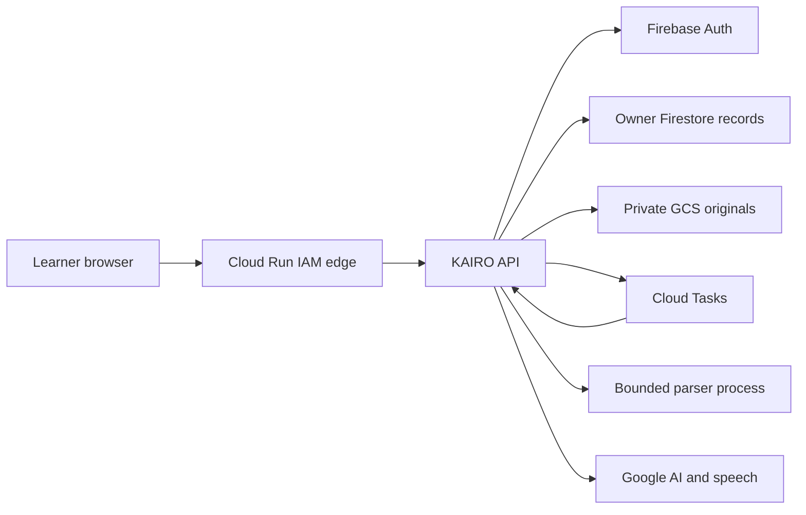

# KAIRO runtime threat model and findings

24 October 2026. Root Codex gpt-6 / effort unknown. This review covers the current private learner deployment, selected local development paths, the staged container and build dependencies. Assumptions are already supplied by the user: user-owned project, private synthetic judge pilot, private uploaded material, consented cloud processing and no browser observation. A larger public or institutional pilot would change these risk rankings. Current cloud metadata is captured in cloud-config.json; do not treat a future revision as automatically assessed.

## System, assets and trust boundaries

Express/Node serves a compiled React/TypeScript client. Firebase Admin verifies session cookies. A server-side repository selects owner paths in Firestore and GCS. Cloud Tasks invokes a private import endpoint with OIDC; a Python/Pillow/PDF/Office/OCR pipeline parses bounded files. Selected reviewed excerpts go to fixed Google AI endpoints. Generated text, citations, questions and learner progress return through the private API.

| Boundary | Data and guarantees | Evidence / remaining uncertainty |
|---|---|---|
| Browser → IAM edge → API | HTTPS; service IAM gate plus separate learner session; same-origin mutations | learner-entry.mjs:24–34; cloud-config.json. Edge access alone must not identify a learner. Public ingress remains unauthorised. |
| API → Firebase | Password exchange to a fixed HTTPS endpoint; recent ID token → secure session; revocation checked | account/routes.mjs:6–12 and authenticate/signout handlers. MFA, verified institutional affiliation and distributed abuse detection are not established. |
| Session → repository | UID supplied by sessionGuard, SHA-256 owner address, kind/ID allowlists, CAS and blob metadata | learner-repository/index.mjs ownerKey/refFor/unpack/getBlob. A UID hash is an address, not encryption or an authorization substitute. |
| API → queue → importer | Expected task audience/service-account email; UID/job ID only in task body | learner-workspace/tasks.mjs. Queue metadata region differs from Johannesburg document storage; do not claim all data remains in South Africa. |
| Upload → parser | Extension/signature prefilter; 8 MiB upload; fixed execFile arguments; 120s/1.1MB output bounds; archive/page/OCR caps | extraction.mjs:10–32; tools/material_ingestion/extract.py. Parser shares container identity/network/env; it is not a strong malware sandbox. |
| Reviewed source → Google model → lesson | Explicit consent, bounded evidence, no connected tools, structured output and citation/support-quote checks | learner-workspace/routes.mjs:41,48; google.mjs generation/help; workspace/model.mjs validateLesson. Prompt wording and citations do not prove semantic correctness or injection immunity. |
| Device → optional tracker | Explicit Start; local same-origin hash-pinned model/worker; camera disposal; no microphone | signing assets/session + learning-flow/AccessDialog. Real-device acceptance remains pending. |
| Developer → deployment | npm lockfile, explicit stage allowlist, non-root container | tools/connected_release/stage.ps1, Dockerfile. Base tag/Python version ranges are mutable; resolved pip inventory alone does not pin later builds. |

Assets: learner source/CV content, identity/session credentials, private derived lessons and evidence, source/citation integrity, runtime IAM identity, model-call budget and service availability. Their confidentiality and integrity matter more than hiding public JS/CSS. Uploaded files, IDs, goals, questions, model responses and client headers are attacker-controlled. Operator credentials and runtime configuration are not available to an ordinary learner. A compromised runtime is a stronger attacker with potentially broad database/auth privileges; this is explicitly a separate scenario.

## Findings and prioritised abuse paths

No comprehensive vulnerability-free conclusion is possible from this scope. Priorities below are engineering judgments, not CVSS scores or proof that every hypothesis is exploitable.

| ID / status | Abuse path and affected boundary | Likelihood / impact / priority | Existing protection, evidence and next action |
|---|---|---|---|
| SEC-01 **reproduced; fixed in source** | An authorised caller rotates recovery emails, creating a new pair-based rate bucket for every provider call | Medium / medium / medium in private pilot; higher exposure if public | security-adversarial test originally observed 61st provider call succeed. Independent 12/account, 60/socket-client, 240/process ten-minute budgets now block before provider, ignore spoofed forwarding headers, and set Retry-After. adversarial-before/after.txt. See release status for deployed fix revision. |
| SEC-02 **residual design risk** | Instance restart resets throttle; concurrent/distributed clients consume recovery/provider resources or exhaust a shared proxy bucket | Medium / medium / medium | maxInstances=1 limits instance count but is not durable throttling. Existing model quotas use transactions, authentication limits do not. Next: distributed transaction-backed counters with privacy-preserving keys, trusted edge client identity and false-positive/expiry/concurrency tests. |
| SEC-03 **residual isolation risk** | A parser/library compromise inherits container network/metadata identity and could reach owner records or external services | Low to medium / high / high before untrusted public upload pilot | Bounded parsers and non-root help availability but do not isolate service credentials; extraction.mjs exec options inherit env. Next: separated worker identity/network, input-only access and output contract; container/Python image scanning. No parser RCE was demonstrated. |
| SEC-04 **verified broad permission, residual risk** | Runtime compromise uses project-wide Firestore/Auth permissions beyond one learner | Low / high / high before broader pilot | Dedicated keyless identity; cloud-config.json shows datastore.user and firebaseauth.admin among roles. Next: justify each required permission, trial reduced custom Auth role and separated importer, run login/revoke/owner isolation regressions. Do not call present roles least-privilege verified. |
| SEC-05 **lifecycle gap** | Deleting an original is mistaken for erasing all derived material, queue copies, soft-deleted storage and provider processing | Medium / medium to high / high before real private-data pilot | Optional original deletion and 7-day bucket soft delete exist. Whole-account cascade/retention contract, provider terms and backup recovery/deletion tests remain open. |
| SEC-06 **supply-chain gap** | A rebuild resolves a different OS/Python package or base image while the team assumes an earlier clean audit applies | Medium / high / high before promotion policy | npm ci/ignore-scripts and npm advisory scan/SBOM present. Docker uses a mutable Node tag and Python ranges; record digest/resolved versions and scan actual OS/Python/image. No known npm advisory at the current scan is not zero total vulnerability risk. |
| SEC-07 **detection gap** | Account abuse, consent decisions or attempted cross-owner access are not reconstructed from app events | Medium / medium / medium | Cloud infrastructure logging is not evidence of a complete privacy-safe application audit trail. Add redacted actor pseudonym/action/result/correlation/revision events, retention, alert ownership and a synthetic incident drill; never log file contents, passwords, cookies or prompts. |
| SEC-08 **AI semantic residual** | Poisoned reviewed source produces a plausible but misleading lesson despite valid citation IDs | Medium / medium to high / high for safety-critical subjects | No tool execution; output projection/citation/quote validation, source review and warning labels. No live hostile-model red-team here. Add consented synthetic corpus, measured attack success/false positives, unsupported-claim tests and educator review. Never use generated guidance for real equipment operation. |

Tests also exercised cross-owner record substitution, protected enrolment/quota fields, cross-origin mutations, oversized/revoked cookies, SQL strings, fabricated citations, malformed packages and archive expansion. They did not demonstrate a bypass in those tested cases. Truncated image prefixes pass cheap admission but the real image decoder rejects them before source pages; this is not demonstrated XSS. Node returning 431 for an oversized header is a fail-closed transport rejection, not an auth defect.

## Framework use and quantum scope

Use OWASP API 2023 for API abuse categories, ASVS 5.0 as a versioned verification catalogue, OWASP LLM 2025 for AI boundary risks and NIST SSDF for lifecycle gates. MITRE ATT&CK's [valid-account technique](https://attack.mitre.org/techniques/T1078/) helps describe stolen-account scenarios; [MITRE ATLAS](https://atlas.mitre.org/) adds AI adversary scenarios. Neither is a compliance certificate or a substitute for this source-level threat model. The separately reviewed [framework map](../security-frameworks-20261024/README.md) contains the complete risk mapping and primary references.

KAIRO does not use quantum computation or self-managed post-quantum encryption. Quantum readiness concerns long-lived encrypted material, asymmetric key establishment and signatures. [NIST FIPS 203](https://csrc.nist.gov/pubs/fips/203/final) standardises ML-KEM; FIPS 204/205 cover ML-DSA/SLH-DSA. Track provider-managed TLS, token/session signatures, data encryption/key wrapping, region, key owner and migration evidence. [Google's PQC roadmap](https://cloud.google.com/security/resources/post-quantum-cryptography) is provider information, not proof that every Cloud Run/Firebase/Firestore/Vertex connection here negotiates PQC. Minimise retention, preserve crypto agility, verify service-specific support before a claim, and do not add homemade cryptography or a “quantum proof” badge.

## Limits and next acceptance

No attacks on Google/FNB/other users; no public scan, flood, credential stuffing, destructive persistence, real learner uploads, browser/camera or live model attack. Test identity/storage/provider doubles isolate actual route behavior; real cloud policy is checked read-only. The full test count and actual private deployment status are in RELEASE-STATUS.json. Tests are evidence for named cases only. An independent authenticated staging assessment and human/device acceptance remain separate gates.
